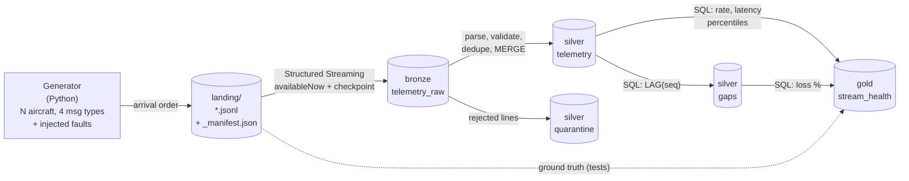

# uav-telemetry-lakehouse

[](https://github.com/sangyou16/uav-telemetry-lakehouse/actions/workflows/ci.yml)

A bronze / silver / gold **Delta Lake** pipeline in **PySpark** that measures
message loss, rate and latency for a fleet of (simulated) UAVs sending telemetry
over an unreliable link. Every number it produces is checked against the
generator's ground truth.

> **All data is synthetic.** Message types, fields and values are invented for
> this repo and do not mirror any real protocol, interface document or flight data.

## Architecture



| layer | table | what it holds | write pattern |
|---|---|---|---|
| landing | `*.jsonl` | lines as the ground receiver wrote them, in arrival order | files |
| bronze | `telemetry_raw` | every line, unparsed, + source file and ingest time | streaming append, checkpointed |
| silver | `telemetry` | one typed row per unique message, payload flattened | `MERGE` insert-only |
| silver | `quarantine` | rejected lines + reason | `MERGE` insert-only |
| silver | `gaps` | one row per sequence gap | overwrite (recomputed) |
| gold | `stream_health` | per aircraft and message type: loss %, rate, latency p50/p95/p99 | overwrite (recomputed) |

## Results

Default run: 5 aircraft, 10 minutes, 4 message types (1, 10, 20 and 0.5 Hz), seed 42.

**Every count matches the ground truth:**

| check | pipeline | ground truth (manifest) |
|---|---:|---:|
| lines landed in bronze | 94,273 | 94,273 |
| corrupt lines quarantined | 101 | 101 |
| duplicates removed | 901 | 903 sent, 2 of them corrupt |
| unique messages in silver | 93,271 | 94,500 sent − 1,229 never delivered |
| missing messages found by gap detection | 1,228 | 1,228 detectable |

The one undetected loss is at the very edge of a stream. A sequence-gap detector
only sees holes *between* two received messages, so loss at the start or end of
a stream is invisible to it. The manifest tracks that separately.

**Per aircraft** (from `gold/stream_health`):

| aircraft | received | missing | loss % | median latency | worst-stream p99 |
|---|---:|---:|---:|---:|---:|
| UAV-001 | 18,615 | 285 | 1.51 | 51 ms | 2.6 s |
| UAV-002 | 18,591 | 309 | 1.63 | 51 ms | 3.2 s |
| UAV-003 | 18,692 | 208 | 1.10 | 51 ms | 1.5 s |
| UAV-004 | 18,662 | 238 | 1.26 | 52 ms | 1.8 s |
| UAV-005 | 18,711 | 188 | 0.99 | 51 ms | 1.2 s |

- **602 gaps** in total: 583 single lost messages, plus link outages up to
  **117 messages / 8 seconds** in a row.
- **Median latency ~51 ms, but p99 in seconds.** That tail comes from late
  messages and store-and-forward bursts. The mean would hide it, which is why
  gold reports percentiles.

## Design decisions

Full details: [docs/DESIGN.md](docs/DESIGN.md).

- **Bronze never parses.** Corrupt lines must survive so silver can quarantine
  and count them; bronze is the record of exactly what arrived.
- **Incremental, idempotent ingest.** Structured Streaming with
  `trigger(availableNow=True)` and a checkpoint processes only new files, then
  stops (the same idea as Databricks Auto Loader). Re-running appends 0 rows.
- **Explicit `_corrupt_record`** in the JSON schema, instead of guessing that a
  row of NULLs means "bad JSON".
- **First arrival wins** for duplicates: `ROW_NUMBER() OVER (PARTITION BY key
  ORDER BY recv_ts)`, then an insert-only `MERGE` on the key, so a duplicate
  arriving in a later batch is not inserted again.
- **Gaps by `seq`, not by arrival time,** so late (out-of-order) messages don't
  create false gaps.
- **Aggregate before joining, `LEFT JOIN` + `COALESCE`** in the loss query, so
  streams with no loss still appear with 0, not NULL or missing.
- **Overwrite for derived tables** (`gaps`, gold): a late message can close an
  old gap, so recomputing is simpler and always correct at this size.
- **Ground truth as the test oracle.** The generator records every fault it
  injects; tests assert the pipeline finds exactly those, per stream.

## Run it

Needs Python 3.11+ and Java 17+. On Windows, use WSL Ubuntu.

```bash
python3 -m venv .venv && source .venv/bin/activate
pip install -e ".[dev,spark]"

python -m uav_lakehouse.generator   # ~94k lines in data/landing/run-42
python -m uav_lakehouse.bronze      # run it twice: the second run appends 0 rows
python -m uav_lakehouse.silver      # telemetry, quarantine, gaps
python -m uav_lakehouse.gold        # prints gold/stream_health

pytest                              # 43 tests, ~2 minutes (Spark startup)
```

## Repo layout

```
src/uav_lakehouse/
  generator/   synthetic telemetry + fault injection + ground-truth manifest
  bronze/      raw lines -> Delta (Structured Streaming)
  silver/      parse, validate, quarantine, dedupe, MERGE; runs gaps.sql
  gold/        runs the gold SQL, joins, writes stream_health
sql/
  silver/gaps.sql          sequence-gap detection (LAG window)
  gold/stream_stats.sql    rate + latency percentiles
  gold/loss.sql            loss % per stream
tests/         pytest per layer, checked against the manifest
docs/DESIGN.md data model, fault model, table schemas, design choices
```

## Tech

PySpark 4.2 · Delta Lake 4.4 · Spark SQL · Python 3.12–3.14 · pytest · ruff ·
GitHub Actions

## At larger scale I would change

- **Read bronze incrementally in silver** (streaming + `foreachBatch` running the
  same MERGE) instead of a full read each run.
- **Partition and cluster** bronze/silver by ingest date and `aircraft_id` once
  volume justifies it; at ~100k rows it would only create small files.
- **Incremental gold** that recomputes only streams touched by new data.
- **Data-quality alerts** on quarantine rate and loss % instead of only tests.
- **Schema evolution** using the `schema_version` field already in every record.

## Status

| step | what | status |
|---|---|---|
| 1 | Generator with injected faults and ground-truth manifest | done |
| 2 | Bronze | done |
| 3 | Silver, including gap detection | done |
| 4 | Gold: loss %, rate, latency percentiles | done |
| 5 | CI on every push (lint + all Spark tests, Python 3.12 and 3.14) | done |
| 6 | S3-compatible storage (MinIO), then Databricks Free Edition | next |
